<div align="center">


# BetterMV

**为网易云音乐中的每一首歌，实时生成专属 MV。**

[](https://github.com/xiaoming6680/NCM-BetterMV/releases/latest)
[](https://github.com/xiaoming6680/NCM-BetterMV/releases)
[](#安装)
[](LICENSE)

[下载](https://github.com/xiaoming6680/NCM-BetterMV/releases/latest) | [安装](#安装) | [使用](#使用) | [更新记录](CHANGELOG.md) | [问题反馈](https://github.com/xiaoming6680/NCM-BetterMV/issues)


</div>

BetterMV 是网易云音乐 PC 版的插件（基于 [BetterNCM](https://github.com/std-microblock/BetterNCM-Installer)）。播放任意一首歌，点一下 MV，它先听完整首歌，再按这首歌的节奏、段落、歌词和封面编排一支 MV，随歌曲实时播放。所有画面都在本机生成，不上传任何数据。

> 本页图中的封面和歌词都是示例。插件使用当前播放歌曲的封面和歌词。

## 目录

- [功能](#功能)
- [安装](#安装)
- [使用](#使用)
- [下载 MV](#下载-mv)
- [直播（OBS）](#直播obs)
- [对齐包：逐字歌词与节拍](#对齐包逐字歌词与节拍)
- [设置](#设置)
- [常见问题](#常见问题)
- [开发者](#开发者)

## 功能

### 先读懂整首歌

识别速度、拍号，以及前奏、主歌、副歌、drop 等段落。镜头按段落切换，动作落在鼓点上，进度条也按段落分格。安装[对齐包](#对齐包逐字歌词与节拍)后，节拍和鼓点改由本机的音频模型识别：切分节奏的歌、鼓打贝斯、音游曲和渐快的歌，也能踩准。

<p align="center">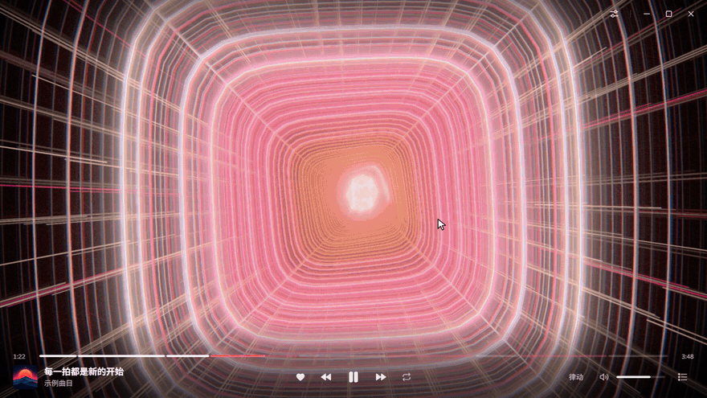</p>

### 歌词在场景之中

正在唱的歌词立在场景里，随演唱逐字出现，有翻译时附带翻译。只有逐句歌词的歌，装了对齐包后也按歌声逐字对齐。

<p align="center">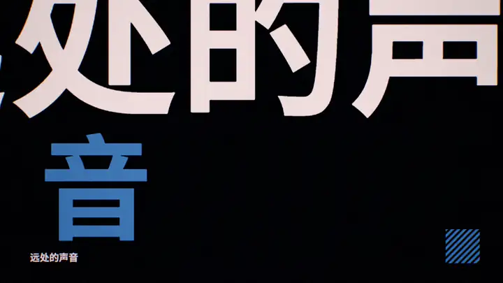</p>

### 颜色只取自封面，每次播放都不同

整支 MV 的配色都取自这首歌的封面，黑白封面生成黑白 MV。共 33 个场景、4 种风格、4 种画风，同一首歌每次播放重新编排。风格默认按曲风和音频自动选择，也可以手动指定。

| 律动 | 抒情 |
|:---:|:---:|
| 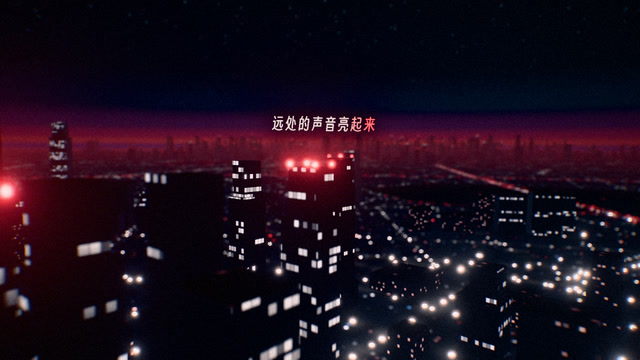 |  |
| **字** | **墨** |
|  |  |

画风会把某些段落换一种媒介重画：

| 孔版印刷 | 像素 | 字符 | 录像带 |
|:---:|:---:|:---:|:---:|
|  | 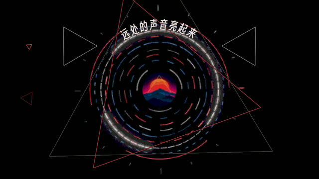 | 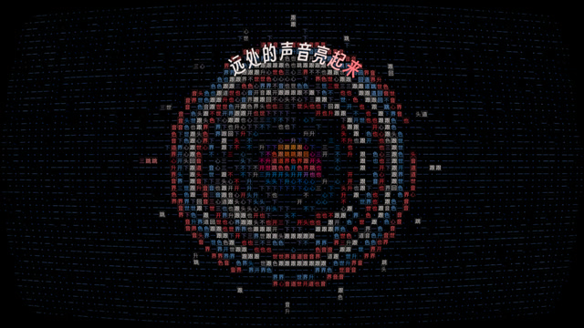 | 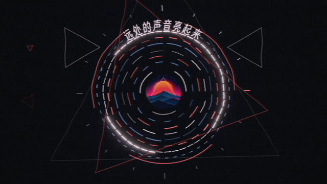 |

<details>
<summary>全部 33 个场景</summary>

<p align="center">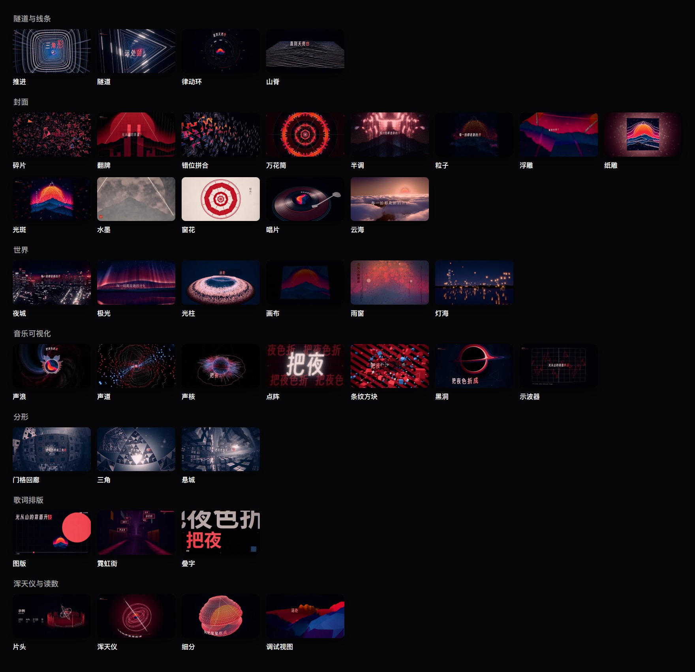</p>

</details>

### 专属浑天仪

每首歌生成一架浑天仪，环数、刻度和转速都来自这首歌。

<p align="center">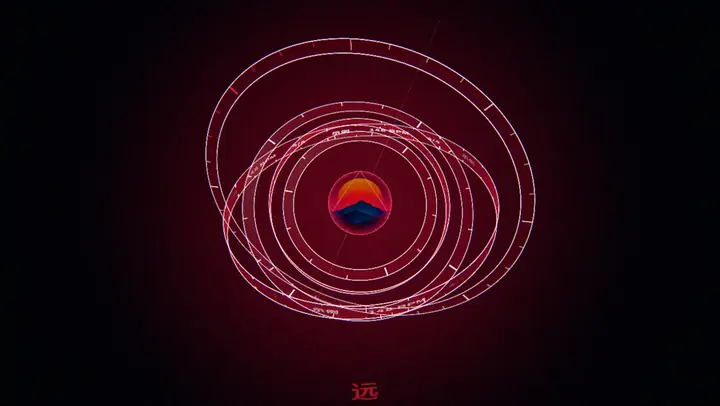</p>

### 下载成视频，也能直播

右键选“下载 MV…”，把 MV 导出成横屏、竖屏或方形的 MP4，可以只导副歌，适合发短视频（见[下载 MV](#下载-mv)）。直播时 OBS 里只显示 MV，网易云的界面不会进直播画面（见[直播（OBS）](#直播obs)）。

## 安装

<p align="center">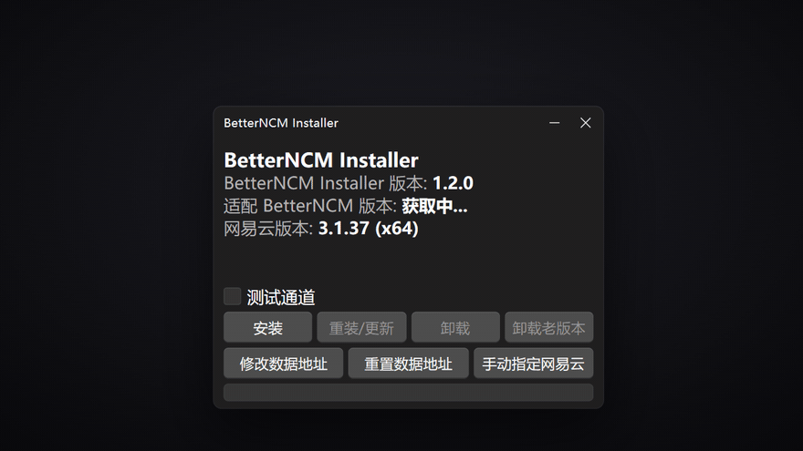</p>

1. **安装 BetterNCM**：下载并运行 [BetterNCM 安装器](https://github.com/std-microblock/BetterNCM-Installer/releases)，点击“安装”。BetterNCM 是网易云音乐 PC 版的开源插件管理器，已安装可跳过。
2. **下载 BetterMV**：在 [Releases](https://github.com/xiaoming6680/NCM-BetterMV/releases/latest) 下载 `BetterMV-版本号.plugin`。
3. **放入插件文件夹**：放进 BetterNCM 的插件文件夹（默认 `C:\betterncm\plugins`），重启网易云音乐。

**运行环境**：Windows、网易云音乐 3.x、BetterNCM 1.3.4 或更高版本。显卡需支持 WebGL 2，并保持网易云“设置 → 常规 → 开启GPU加速”开启。

| 显卡 | 建议 |
|---|---|
| GTX 1650、RTX 3050 及以上的独立显卡 | 默认的“自动”或“高”画质 |
| Iris Xe、Radeon 680M 及以上的集成显卡 | “中”或“低” |
| 更早的集成显卡 | “低”，帧率上限设为 30 |

以上按 1080p 窗口估计（[依据](docs/PERFORMANCE.md#配置要求)）。

**更新**：在设置的“更新”中点击“更新”，重启网易云后生效。BetterMV 每天检查一次新版本，有新版本时弹出更新窗口，MV 页右上角的设置按钮上也会出现红点；无法连接 GitHub 时，可在窗口中打开发布页手动下载。手动放入新版本也可以，重启后会自动删除旧版本的 `.plugin`。从 0.9.1 及更早版本升级时，请先手动删除旧文件：同时存在多个版本时，只有文件名排在最后的那个生效，未必是新版本。

**卸载**：删除插件文件夹中的 `BetterMV-*.plugin`，重启网易云。

## 使用

<p align="center">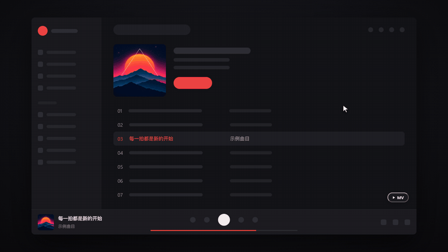</p>

1. 在网易云中播放一首歌，点击播放栏上方的 **MV**，或按 **Ctrl+Shift+M**。
2. 首次打开一首歌时，BetterMV 先分析整首歌（一首四分半的歌约 3 秒，装了对齐包时另需几秒识别节拍），随后 MV 随歌曲播放。再次打开同一首歌立即播放。
3. 按 **Esc** 退出 MV 页，音乐继续播放。

### 控制栏

移动鼠标时出现，静止后隐藏：喜欢、切歌、播放模式、进度、音量和播放列表。进度条按段落分格，悬停时显示段落和时间。

<p align="center">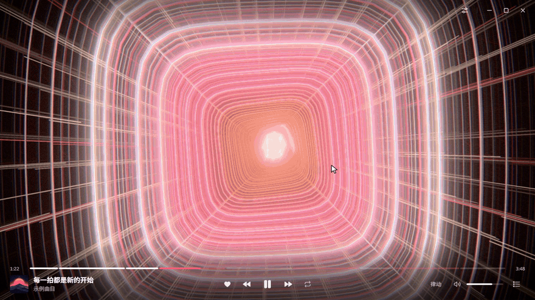</p>

**快捷键**：空格播放或暂停，← → 快退或快进，↑ ↓ 调节音量，Esc 退出；网易云自身的 Ctrl+← → 切歌同样有效。

### 右键菜单

在 MV 页右键：播放或暂停、喜欢、换一种编排、切换风格、保存当前画面、下载 MV、显示控制栏、设置、退出。可以用方向键选择、回车确认、Esc 关闭。

<p align="center">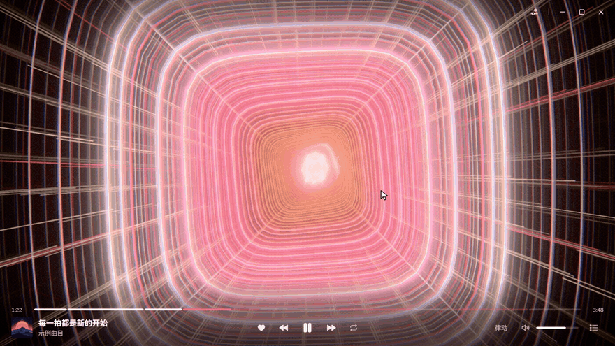</p>

## 下载 MV

在 MV 页右键选择“下载 MV…”，选好后点“导出”。

<p align="center">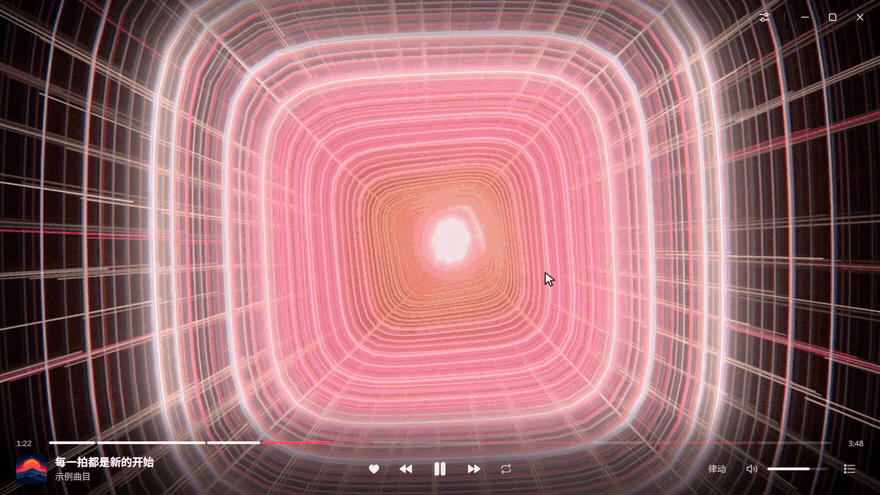</p>

- **画幅**：横屏 16:9、竖屏 9:16、方形 1:1。**清晰度**：720p、1080p、4K。**帧率**：30 或 60。**画质**：标准、高、极高。
- **范围**：整首、副歌，或自己填起止时间。发短视频可选“竖屏 + 副歌”。面板里会显示预计的文件大小和耗时。
- 文件保存在网易云下载目录的 `BetterMV` 文件夹，完成后点提示里的“在文件夹中显示”。
- 画面逐帧生成，不用等歌曲重新播放。导出时可以退出 MV 页，进度显示在播放栏上方的小条上，也可以在那里取消，歌曲照常播放。
- 视频用 Windows 自带的硬件编码生成，导出时后台运行本机程序 BetterMV Encode，导出结束随之结束。系统缺少媒体组件或程序被安全软件拦截时，自动改用较慢的兼容模式（整首、1080p）。

## 直播（OBS）

直播画面里只显示 MV，网易云的界面和搜歌等操作不会被采集。

1. 在设置的“直播”中打开“OBS 输出”。
2. 把设置里的地址（`http://127.0.0.1:32109/`）拖到 OBS 的预览区并确认。
3. 声音由 OBS 的“桌面音频”采集。

- **先打开 OBS、后打开网易云时，OBS 中的画面不会自动出现**：在 OBS 中右键 BetterMV 来源，选择“刷新”。先打开网易云，或网易云在 OBS 开着时重新打开，画面都会自动出现。
- OBS 显示画面时，网易云中的 MV 页暂停渲染；需要两边同时显示时，打开“MV 页同时显示”。打开 OBS 输出后，后台运行本机服务 BetterMV OBS，网易云退出时随之结束。

## 对齐包：逐字歌词与节拍

可选安装，在设置的“歌词与对齐”中一键下载（约 490 MB），之后全程在本机运行：

- **逐字歌词**：网易云多数歌只有逐句歌词，插件只能按音节估算每个字的时间。装了对齐包后，第一次播放这样的歌时按歌声对齐每个字，结果按歌保存。
- **节拍**：每首歌第一次分析时，用音频模型识别节拍，再由插件整理。镜头和动作更多落在实际的鼓点上；切分节奏、鼓打贝斯、音游曲和渐快的歌提升明显。
- **鼓点**：同时用一个鼓点模型识别底鼓、军鼓和镲，场景跟着鼓点的动作更少错位。模型约 2 MB，第一次用到时自动下载；已经分析过的歌只补识别鼓点，几秒内完成。

旧版对齐包（只有逐字歌词）需要更新：设置中会显示“需要更新”，点击后只下载新增的部分（约 130 MB）。不装对齐包时，插件照常工作，逐字时间按音节估算，节拍由插件自己识别。

<details>
<summary>手动安装对齐包（无法连接 GitHub 或下载中断时）</summary>

1. 在[对齐包发布页](https://github.com/xiaoming6680/NCM-BetterMV/releases/tag/aligner-v2)下载 `aligner-runtime.zip`、`mms_fa.onnx.001`～`mms_fa.onnx.004`、`beat_this.onnx.001` 和 `beat_mel.npy`，共 7 个文件，约 490 MB。从旧版更新时，已有的 `mms_fa.onnx`（或它的四个分卷）不用重新下载。
2. 打开 BetterNCM 的数据目录（插件文件夹的上一级，默认 `C:\betterncm`），进入 `BetterMV\aligner`，没有就新建这两层文件夹。
3. 把 `aligner-runtime.zip` 解压到 `aligner` 中，覆盖已有文件。解压后 `align.py` 和 `python` 文件夹应直接位于 `aligner` 下，不要多出一层 `aligner-runtime` 文件夹。
4. 在 `aligner` 中新建 `models` 文件夹（已有就直接用），放入下载的 `.onnx.00x` 文件和 `beat_mel.npy`。鼓点模型 `adtof_frame_rnn.onnx`（约 2 MB，同一发布页）也可以一并放入；不放时插件第一次用到会自动下载。
5. 在 `aligner` 中新建文本文件 `installed.json`（已有就改写），内容为 `{"version":2}`。注意扩展名是 `.json`，不是 `.txt`。
6. 重启网易云。设置“开始使用”中的“对齐包”显示“已安装”即完成。

完成后的文件夹：

```text
C:\betterncm\BetterMV\aligner\
├─ align.py、fa.py、beats.py、version.json、LICENSES.txt、installed.json
├─ python\
└─ models\mms_fa.onnx.001～.004、beat_this.onnx.001、beat_mel.npy、adtof_frame_rnn.onnx
```

模型分卷在首次使用时于本机拼合为一个文件。

</details>

## 设置

两个入口，设置相同：

- **BetterNCM 的插件管理界面中选择 BetterMV**：左侧按分区排列，“开始使用”列出打开方式和运行状态（歌曲缓存、显卡、对齐包、版本）。
- **MV 页右上角的齿轮**：播放中调整即时生效。首页是当前歌曲和常用设置，其余分区点击进入；场景悬停可看示意图。

<p align="center">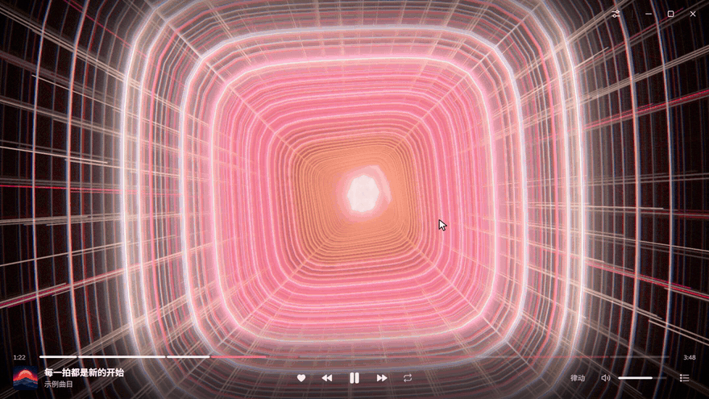</p>

| 需要 | 设置方法 |
|---|---|
| 画面卡顿、风扇噪音大 | 默认的“自动”画质会在显卡吃力时降低清晰度；仍卡顿时调为中或低，或将帧率上限设为 30，集成显卡建议选“低” |
| 戴蓝牙耳机时画面早于声音 | “画面延迟”调为 +150～250 ms |
| 某首歌的歌词偏早或偏晚 | MV 页设置中的“歌词延迟”，只对当前歌曲生效 |
| 换一种画面，或每次都一样 | MV 页设置中点击“换一种”；“画面编排”可改为固定 |
| 风格不合适 | “风格”改为律动、抒情、字或墨 |
| 不喜欢某个场景或画风 | 在“场景”“画风”中关闭，点击“应用” |
| 切歌时不想等待 | 开启“提前分析下一首” |
| 逐字歌词更准、节拍和鼓点更准 | 在“歌词与对齐”中下载对齐包（约 490 MB） |
| 不显示播放栏上方的 MV 按钮 | 关闭“MV 按钮”，改用快捷键打开 |

<p align="center">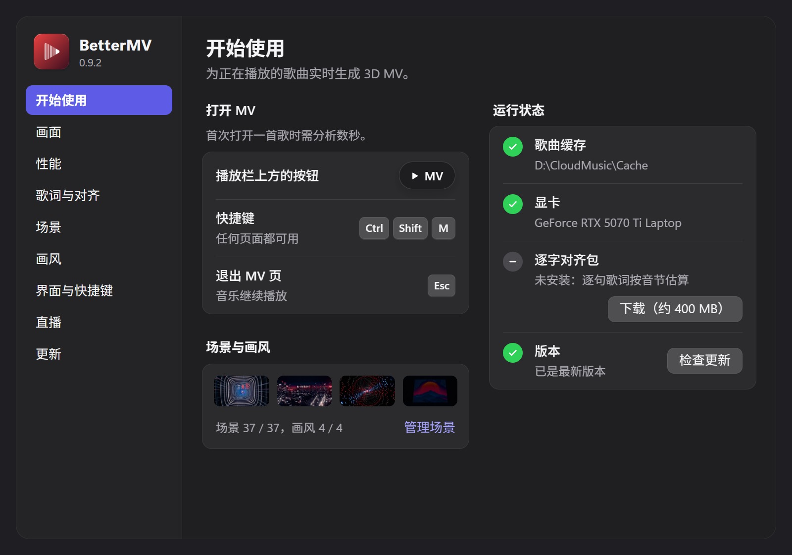</p>

## 常见问题

<details>
<summary><b>需要联网吗？会上传哪些内容？</b></summary>

音频使用网易云的本地缓存，未缓存完整或缓存目录无法读取时，按标准音质向网易云获取；歌词、封面和曲风标签同样来自网易云。对齐包从 GitHub 下载一次，之后在本机运行。检查更新每天访问一次 GitHub，可在设置中关闭。所有画面在本机生成，不上传任何数据。

</details>

<details>
<summary><b>镜头切换的位置不对？</b></summary>

段落识别不一定准确：对照网易云标出的副歌片段，约 85% 的副歌能被正确识别，其余可能把铺垫认成副歌，或边界偏差一两小节。节拍对不上鼓点时，安装对齐包通常会改善。欢迎附上歌曲名反馈。

</details>

<details>
<summary><b>风格选得不对？</b></summary>

风格依据网易云的曲风标签和音频选择，无标签的说唱、国风无法自动识别，可在设置中手动指定。

</details>

<details>
<summary><b>逐字歌词不准？</b></summary>

没有逐字歌词的歌曲按音节估算每个词的时间；安装对齐包后按音频对齐，但和声、重度处理的人声和日语歌词中的汉字仍可能不准。可用“歌词延迟”整体调整。

</details>

<details>
<summary><b>OBS 中没有画面，设置中显示“等待 OBS 连接”？</b></summary>

OBS 先于网易云打开时，浏览器来源加载不到画面，之后也不会自动重试。在 OBS 中右键 BetterMV 来源，选择“刷新”。

</details>

<details>
<summary><b>画面中断，提示“显卡被重置”？</b></summary>

点击“重试”重新生成画面。频繁出现时，调低画质或关闭分形等对显卡要求较高的场景。

</details>

<details>
<summary><b>安装 BetterNCM 后网易云无法打开？</b></summary>

重新运行 BetterNCM 安装器并点击“卸载”，即可恢复。

</details>

目前仅在网易云音乐 3.1.37 + BetterNCM 1.3.4、一台 RTX 5070 Ti 笔记本上测试过。遇到问题或画面观感不佳，欢迎在 [Issues](https://github.com/xiaoming6680/NCM-BetterMV/issues) 中反馈，附上歌曲名称会很有帮助。

## 开发者

需要 [Bun](https://bun.sh)。开发文档见 [docs/](docs/)。

```sh
bun install
bun run dev      # 浏览器预览：http://localhost:5190/?id=歌曲ID（歌曲需已在网易云中完整播放一遍）
bun run plugin   # 安装到 BetterNCM 的开发插件目录，重启网易云后生效
bun run pack     # 打包为 dist/ncm-better-mv.plugin
```

## 开源协议

GPL-3.0-or-later。内置字体 Archivo、Bodoni Moda、Cormorant Garamond、得意黑（Smiley Sans）、霞鹜文楷 Lite 均使用 SIL Open Font License 1.1（`public/fonts/OFL.txt`），打包进插件的 three.js 使用 MIT 协议。可选对齐包中的 MMS-FA 模型来自 Meta，使用 CC BY-NC 4.0（不可商用）；节拍模型 Beat This! 来自 JKU Linz 计算感知研究所，使用 MIT 协议；鼓点模型来自 ADTOF（M. Zehren、M. Alunno、P. Bientinesi），使用 CC BY-NC-SA 4.0（不可商用），署名和说明随模型放在 `models` 文件夹中；其余组件见包内的 `LICENSES.txt`。

作者 [XIAOMING6680](https://github.com/xiaoming6680)。
