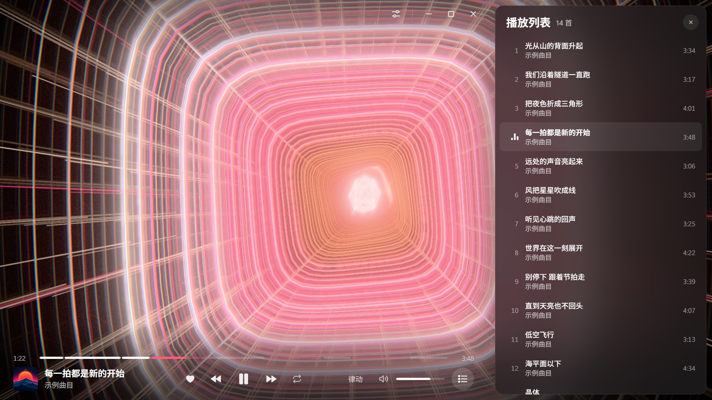

<div align="center">


# BetterMV

**为网易云音乐中的每一首歌，实时生成专属 MV。**

[下载](https://github.com/xiaoming6680/NCM-BetterMV/releases/latest) | [更新记录](CHANGELOG.md) | [问题反馈](https://github.com/xiaoming6680/NCM-BetterMV/issues)

</div>

## 功能

- **先读懂整首歌**：识别速度、拍号，以及前奏、主歌、副歌、drop 等段落；镜头按段落切换，动作落在重拍上。
- **颜色只取自封面**：每首歌的画面各不相同，黑白封面生成黑白 MV。
- **歌词在场景之中**：一句歌词立在场景里，随演唱逐词出现，有翻译时附带翻译。
- **每次播放都不同**：37 个场景、4 种风格（律动、抒情、字、墨）、4 种画风（孔版印刷、像素、字符、录像带），同一首歌每次播放重新编排。
- **专属浑天仪**：每首歌生成一架浑天仪，环数、刻度与转速都来自这首歌。
- **直播时只给 MV**：OBS 中只显示 MV，网易云的界面不会进入直播画面（见[直播（OBS）](#直播obs)）。
- **导出成视频**：右键选“下载 MV…”，导出横屏、竖屏或方形的 MP4，可只导副歌或指定一段，用于发短视频（见[导出视频](#导出视频)）。
- **全部在本机生成**：不上传任何数据。

<p align="center"></p>

> 图中的封面和歌词仅为示意，插件使用当前播放歌曲的封面和歌词。

## 安装

1. **安装 BetterNCM**：下载并运行 [BetterNCM 安装器](https://github.com/std-microblock/BetterNCM-Installer/releases)，点击“安装”。BetterNCM 是网易云音乐 PC 版的开源插件管理器，已安装可跳过。
2. **放入插件**：从 [Releases](https://github.com/xiaoming6680/NCM-BetterMV/releases/latest) 下载 `BetterMV-版本号.plugin`，放入 BetterNCM 的插件文件夹（默认 `C:\betterncm\plugins`）。
3. **重启网易云音乐**。

**更新**：在设置的“更新”中点击“更新”，重启网易云后生效；BetterMV 每天自动检查一次新版本，有新版本时弹出更新窗口，MV 页右上角的设置按钮上也会出现红点；无法连接 GitHub 时，可在窗口中打开发布页手动下载。手动放入新版本也可以，重启后新版本会自动删除旧版本的 `.plugin` 文件。从 0.9.1 及更早版本升级时，请手动删除旧版本的文件：同时存在多个版本时只有文件名排在最后的那个生效，未必是新版本。**卸载**：删除插件文件夹中的 `BetterMV-*.plugin`，重启网易云。

运行环境：Windows、网易云音乐 3.x、BetterNCM 1.3.4 或更高版本，显卡需支持 WebGL 2，并保持网易云「设置 → 常规 → 开启GPU加速」开启。配置建议：1080p 窗口下，GTX 1650、RTX 3050 及以上的独立显卡用默认的“自动”或“高”画质；Iris Xe、Radeon 680M 及以上的集成显卡选“中”或“低”；更早的集成显卡选“低”，并将帧率上限设为 30（[依据](docs/PERFORMANCE.md#配置要求)）。

## 使用

1. 在网易云中播放一首歌，点击播放栏上方的 **MV**，或按 **Ctrl+Shift+M**。
2. 首次打开一首歌时，BetterMV 先分析整首歌曲（一首四分半的歌约 3 秒），随后 MV 随歌曲播放。
3. 按 **Esc** 退出 MV 页，音乐继续播放。

<p align="center"></p>

- **控制栏**：移动鼠标时出现，静止后隐藏。包括喜欢、切歌、播放模式、进度、音量和播放列表；进度条按段落分格，悬停时显示段落与时间。
- **右上角**：设置、最小化、最大化、退出。
- **快捷键**：空格播放 / 暂停，← → 快退 / 快进，↑ ↓ 调节音量，Esc 退出；网易云自身的 Ctrl+← → 切歌同样有效。

## 导出视频

在 MV 页右键选择“下载 MV…”，选好后点“导出”：

- **画幅**：横屏 16:9、竖屏 9:16、方形 1:1。**清晰度**：720p、1080p、4K。**帧率**：30 或 60。**画质**：标准、高、极高。
- **范围**：整首、副歌，或自己填起止时间。发短视频可选“竖屏 + 副歌”。面板里会显示预计的文件大小和耗时。
- 文件保存在网易云下载目录的 `BetterMV` 文件夹，完成后点提示里的“在文件夹中显示”。
- 画面逐帧生成，不用等歌曲重新播放。导出时可以退出 MV 页，进度显示在播放栏上方的小条上，也可以在那里取消，歌曲照常播放。
- 视频用 Windows 自带的硬件编码生成，后台会运行本机程序 BetterMV Encode，导出结束随之结束。系统缺少媒体组件或程序被安全软件拦截时，自动改用较慢的兼容模式（整首、1080p）。

## 设置

两个入口，设置相同：

- **BetterNCM 的插件管理界面中选择 BetterMV**：左侧按分区排列，“开始使用”列出打开方式和运行状态（歌曲缓存、显卡、对齐包、版本），其余分区一次显示一个。
- **MV 页右上角的齿轮**：播放中调整即时生效。首页是当前歌曲和常用设置，其余设置在“全部设置”中点击进入。

<p align="center"></p>

| 需要 | 设置方法 |
|---|---|
| 画面卡顿、风扇噪音大 | 默认的“自动”画质会在显卡吃力时降低清晰度；仍卡顿时调为中或低，或将帧率上限设为 30，集成显卡建议选“低” |
| 戴蓝牙耳机时画面早于声音 | “画面延迟”调为 +150～250 ms |
| 某首歌的歌词偏早或偏晚 | MV 页设置中的“歌词延迟”，只对当前歌曲生效 |
| 换一种画面，或每次都一样 | MV 页设置中点击“换一种”；“画面编排”可改为固定 |
| 风格不合适 | “风格”改为律动、抒情、字或墨 |
| 不喜欢某个场景或画风 | 在“场景”“画风”中关闭，点击“应用” |
| 切歌时不想等待 | 开启“提前分析下一首” |
| 只有逐句歌词的歌曲也逐字显示 | 在“歌词与对齐”中下载对齐包（约 400 MB），按音频对齐每个字；下载失败时可[手动安装](#手动安装对齐包) |
| 不显示播放栏上方的 MV 按钮 | 关闭“MV 按钮”，改用快捷键打开 |

## 直播（OBS）

直播画面中只显示 MV，网易云的界面和搜歌等操作不会被采集。

1. 在设置的“直播”中打开“OBS 输出”。
2. 把设置里的地址（`http://127.0.0.1:32109/`）拖到 OBS 的预览区并确认。
3. 声音由 OBS 的“桌面音频”采集。

**先打开 OBS、后打开网易云时，OBS 中的画面不会自动出现**：在 OBS 中右键 BetterMV 来源，选择“刷新”。先打开网易云，或网易云在 OBS 开着时重新打开，画面都会自动出现。

OBS 显示画面时，网易云中的 MV 页暂停渲染，需要两边同时显示时打开“MV 页同时显示”。打开 OBS 输出后，后台会运行本机服务 BetterMV OBS，网易云退出时随之结束。

## 手动安装对齐包

对齐包通常在设置的“歌词与对齐”中一键下载。无法连接 GitHub 或下载中断时，可以手动安装：

1. 在[对齐包发布页](https://github.com/xiaoming6680/NCM-BetterMV/releases/tag/aligner-v1)下载 `aligner-runtime.zip` 和 `mms_fa.onnx.001`～`mms_fa.onnx.004`，共 5 个文件，约 400 MB。
2. 打开 BetterNCM 的数据目录（插件文件夹的上一级，默认 `C:\betterncm`），进入 `BetterMV\aligner`，没有就新建这两层文件夹。
3. 把 `aligner-runtime.zip` 解压到 `aligner` 中。解压后 `align.py` 和 `python` 文件夹应直接位于 `aligner` 下，不要多出一层 `aligner-runtime` 文件夹。
4. 在 `aligner` 中新建 `models` 文件夹，放入四个 `mms_fa.onnx.00x` 文件。
5. 在 `aligner` 中新建文本文件 `installed.json`，内容为 `{"version":1}`。注意扩展名是 `.json`，不是 `.txt`。
6. 重启网易云。设置“开始使用”中的“逐字对齐包”显示“已安装”即完成。

完成后的文件夹：

```text
C:\betterncm\BetterMV\aligner\
├─ align.py、fa.py、version.json、LICENSES.txt、installed.json
├─ python\
└─ models\mms_fa.onnx.001～mms_fa.onnx.004
```

首次对齐时，四个模型分卷会在本机拼合为一个文件。

## 常见问题

**需要联网吗？会上传哪些内容？**
音频使用网易云的本地缓存，未缓存完整或缓存目录无法读取时，按标准音质向网易云获取；歌词、封面和曲风标签同样来自网易云。对齐包从 GitHub 下载一次，之后在本机运行。检查更新每天访问一次 GitHub，可在设置中关闭。所有画面在本机生成，不上传任何数据。

**镜头切换的位置不对？**
段落识别不一定准确：对照网易云标出的副歌片段，约 85% 的副歌能被正确识别，其余可能把铺垫认成副歌，或边界偏差一两小节。欢迎附上歌曲名反馈。

**风格选得不对？**
风格依据网易云的曲风标签和音频选择，无标签的说唱、国风无法自动识别，可在设置中手动指定。

**逐字歌词不准？**
没有逐字歌词的歌曲按音节估算每个词的时间；安装对齐包后按音频对齐，但和声、重度处理的人声和日语歌词中的汉字仍可能不准。可用“歌词延迟”整体调整。

**OBS 中没有画面，设置中显示“等待 OBS 连接”？**
OBS 先于网易云打开时，浏览器来源加载不到画面，之后也不会自动重试。在 OBS 中右键 BetterMV 来源，选择“刷新”。

**画面中断，提示“显卡被重置”？**
点击“重试”重新生成画面。频繁出现时，调低画质或关闭分形等对显卡要求较高的场景。

**安装 BetterNCM 后网易云无法打开？**
重新运行 BetterNCM 安装器并点击“卸载”，即可恢复。

目前仅在网易云音乐 3.1.37 + BetterNCM 1.3.4、一台 RTX 5070 Ti 笔记本上测试过。遇到问题或画面观感不佳，欢迎在 [Issues](https://github.com/xiaoming6680/NCM-BetterMV/issues) 中反馈，附上歌曲名称会很有帮助。

## 开发者

需要 [Bun](https://bun.sh)。开发文档见 [docs/](docs/)。

```sh
bun install
bun run dev      # 浏览器预览：http://localhost:5190/?id=歌曲ID（歌曲需已在网易云中完整播放一遍）
bun run plugin   # 安装到 BetterNCM 的开发插件目录，重启网易云后生效
bun run pack     # 打包为 dist/ncm-better-mv.plugin
```

## 开源协议

GPL-3.0-or-later。内置字体 Archivo、Bodoni Moda、Cormorant Garamond、得意黑（Smiley Sans）、霞鹜文楷 Lite 均使用 SIL Open Font License 1.1（`public/fonts/OFL.txt`），打包进插件的 three.js 使用 MIT 协议。可选对齐包中的 MMS-FA 模型来自 Meta，使用 CC BY-NC 4.0（不可商用），其余组件见包内的 `LICENSES.txt`。

作者 [XIAOMING6680](https://github.com/xiaoming6680)。
